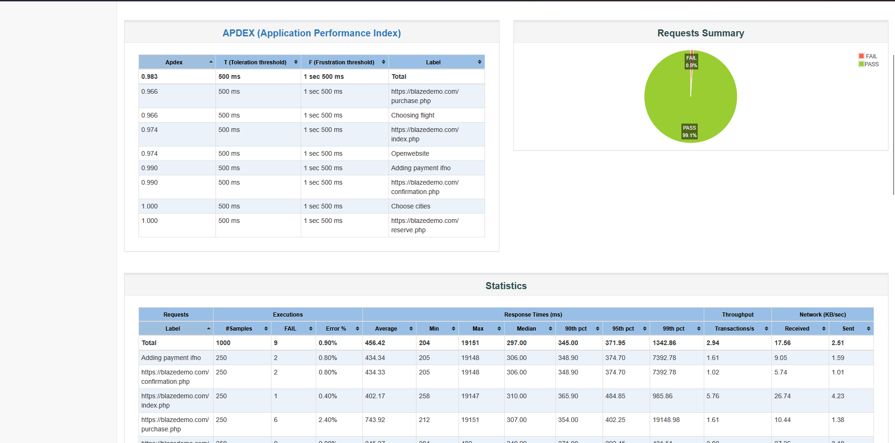
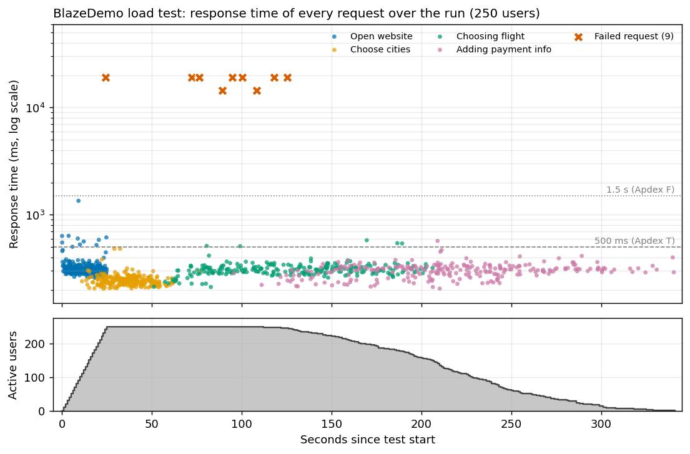

# Load Testing a Flight-Booking Flow with Apache JMeter

250 virtual users run a four-step ticket-booking journey against [BlazeDemo](https://blazedemo.com), a public demo travel site commonly used for load-testing practice. The project covers building the test plan, running it, and reading the results critically.

> Personal practice project against a public demo site. The results come from one run on one machine and are indicative only.

## The 30-second version

- **Load:** 250 users, 1,000 requests, a 5 min 41 s run.
- **Result:** typical requests took about 0.3 s (median 297 ms) and 99.1% succeeded.
- **Finding:** all 9 failures were connection timeouts, not application errors, and they came in a cluster in the middle of the run.
- **Lesson:** the 456 ms *average* hides this. The median and the failure pattern tell you waht is real

## Start here: a 2-minute tour

| If you want to see | Open | What you will see |
|---|---|---|
| The headline numbers | [docs/dashboard-statistics.png](docs/dashboard-statistics.png) | JMeter's own dashboard: Apdex and the statistics table |
| Every request on one chart | [docs/response-times-over-time.png](docs/response-times-over-time.png) | response time of all 1,000 requests, with the 9 failures marked |
| How the test is built | [test-plan/BlazeDemo_Booking_Flow.jmx](test-plan/BlazeDemo_Booking_Flow.jmx) | the JMeter test plan (open it in JMeter: File → Open) |
| The raw data | [results/BlazeDemo_run.jtl](results/BlazeDemo_run_2026-09-20.jtl) | one line per request, readable in any text editor |

The tree and the sample rows below show what is inside those files, so you can read the whole story here on

## Results

Run with Apache JMeter 5.6.3 on Windows 11.

| Metric | Value |
|---|---|
| Load | 250 users, 1 iteration each, 25 s ramp-up |
| Requests sent | 1,000 (4 per user) |
| Test duration | 5 min 41 s |
| Error rate | **0.90 %** (9 of 1,000) |
| Median response time | **297 ms** |
| 90th / 95th / 99th percentile | 345 ms / 372 ms / 1,343 ms |
| Average / max | 456 ms / 19,151 ms |
| Throughput | 2.94 requests/s (run average) |
| Apdex (T = 500 ms, F = 1.5 s) | 0.983 |

Percentiles are as reported by JMeter's HTML dashboard



### Per step

| Step | Request | Samples | Errors | Avg (ms) | Apdex |
|---|---|---|---|---|---|
| Open website | `GET /index.php` | 250 | 1 (0.40 %) | 402 | 0.974 |
| Choose cities | `POST /reserve.php` | 250 | 0 | 245 | 1.000 |
| Choosing flight | `POST /purchase.php` | 250 | 6 (2.40 %) | 744 | 0.966 |
| Adding payment info* | `POST /confirmation.php` | 250 | 2 (0.80 %) | 434 | 0.990 |

\* Labelled `Adding payment ifno` in the raw results.

## So, what the data means

1. **Typical response times are healthy.** All 991 successful requests returned HTTP 200. 98.3 % of them (974) finished within 500 ms, and their average was 296 ms.
2. **The 456 ms average is misleading.** It's pulled up by nine failed requests that each waited 14 to 19 seconds before giving up. The median and percentiles describe the user experience far better, a good reminder not to judge a load test by its average alone.
3. **Every failure was a connection problem, not an application error.** All nine were `java.net.SocketException`s: seven connection attempts that timed out after about 19 s and two "connection reset" errors after about ~14s. The connect time equals the full elapsed time and latency is 0, so these requests never received a response. No request returned an HTTP 4xx or 5xx.
4. **The failures were clustered, not random.** One happened at 24 s, as the ramp-up finished. The other eight started between 72 s and 125 s into the run: six on `purchase.php` and two on `confirmation.php`, while roughly 240 to 250 users were still active.
5. **The cause cannot be determined from this data.** Connection timeouts could come from the demo site limiting connections, the network path, or the load generator itself. Isolating it would take a repeat run from another network or machine and a step-load test.
6. **"250 users" is not "250 simultaneous requests".** Think times (10–40 s, then 30–150 s twice) mean the busiest 30-second window averaged about 10~ requests/s (the initial burst) and the whole run only 3~ requests/s. This tests 250 concurrent *sessions*, not a high-throughput stress test.



## How the test plan is built

This is the structure you will see when you open the `.jmx` file in JMeter:

```
Test Plan "blazemeter"
├── Config: HTTP Header Manager, User Defined Variables, HTTP Request Defaults,
│           DNS Cache Manager, HTTP Cookie Manager, HTTP Cache Manager
└── Thread Group: 250 users, 25 s ramp-up, 1 loop
    ├── Transaction "Open website"        → GET  /index.php        (no wait before)
    ├── Transaction "Choose cities"       → POST /reserve.php      (wait 10–40 s before)
    ├── Transaction "Choosing flight"     → POST /purchase.php     (wait 30–150 s before)
    ├── Transaction "Adding payment ifno" → POST /confirmation.php (wait 30–150 s before)
    ├── Listener: Summary Report
    └── Listener: Aggregate Report
```

Each virtual user walks through the four steps once, pausing between steps like a real person filling in a form (the pauses are Uniform Random Timers). The POST requests send fixed values: Boston → Berlin, one flight, dummy payment details.

## What the raw results are like

Each line in the `.jtl` file is one request. Here are four of the 1,000 (columns shortened):

| label | responseCode | elapsed (ms) | success | connect (ms) |
|---|---|---|---|---|
| https://blazedemo.com/index.php | 200 | 551 | true | 313 |
| https://blazedemo.com/reserve.php | 200 | 240 | true | 0 |
| https://blazedemo.com/confirmation.php | 200 | 285 | true | 57 |
| https://blazedemo.com/index.php | Non HTTP response code: java.net.SocketException | 19147 | **false** | 19147 |

The last row is what a failure looks like: no HTTP status at all, and the connect time equals the whole 19 seconds, which means the connection was never established.

## Repository layout

```
jmeter-load-testing/
├── test-plan/BlazeDemo_Booking_Flow.jmx
├── results/BlazeDemo_run_2026-09-20.jtl
├── docs/
│   ├── dashboard-statistics.png
│   └── response-times-over-time.png
└── README.md
```

## How to reproduce

Requirements: Java and Apache JMeter 5.6.x.

Run the plan in non-GUI mode (the recommended way to execute load tests) and generate the HTML dashboard:

```bash
jmeter -n -t test-plan/BlazeDemo_Booking_Flow.jmx -l results/new_run.jtl -e -o report/
```

The `report/` folder must not exist yet or must be empty. To rebuild the dashboard from the included results instead:

```bash
jmeter -g results/BlazeDemo_run_2026-09-20.jtl -o report/
```

BlazeDemo is a shared public site, so please don't scale this plan up without a good reason.

## Limitations

- **No content assertions.** Success is judged by HTTP status only.
- **Static test data.** Every user books the same route and flight with the same dummy card.
- **No server-side visibility.** As this is a third-party site, the cause of the connection failures stays unconfirmed.

## Author

Vladyslav Saulenko, QA Engineer · [GitHub](https://github.com/voidtess) · [LinkedIn](https://www.linkedin.com/in/voidtess)
